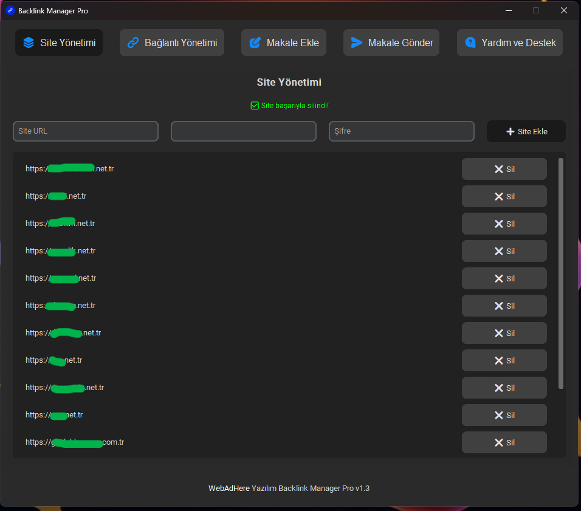
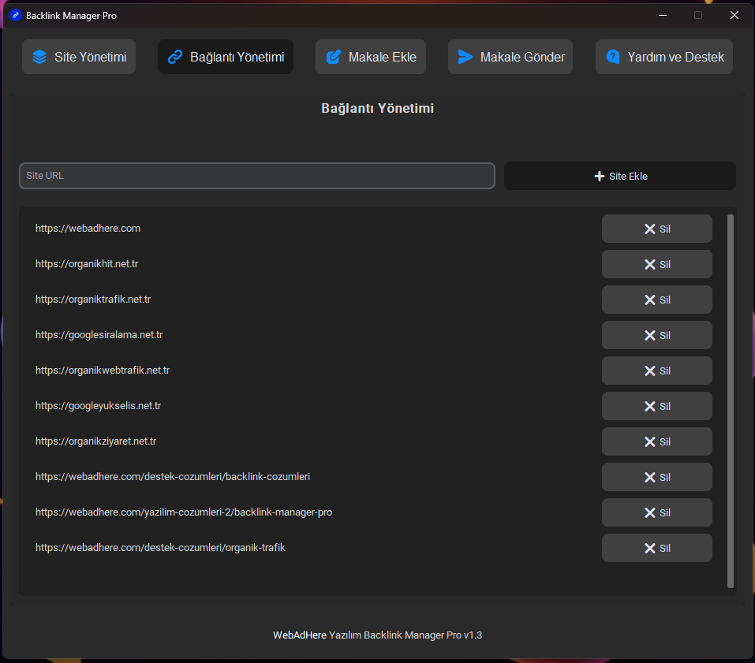
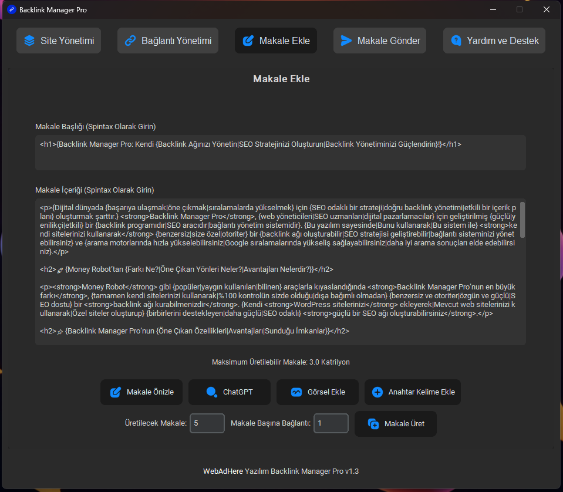
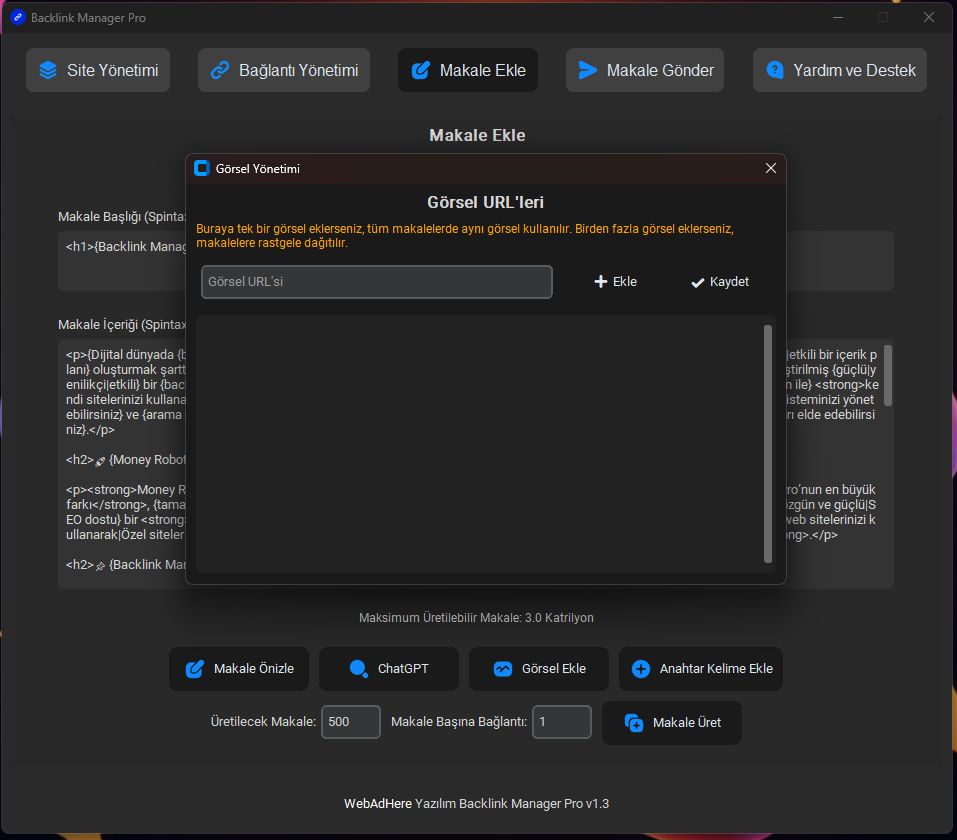
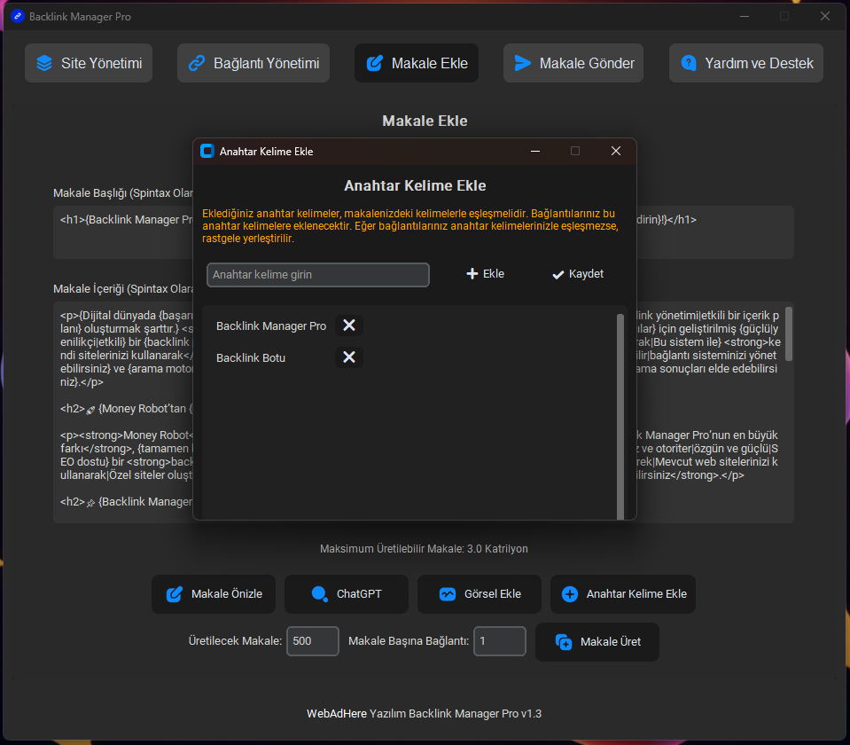
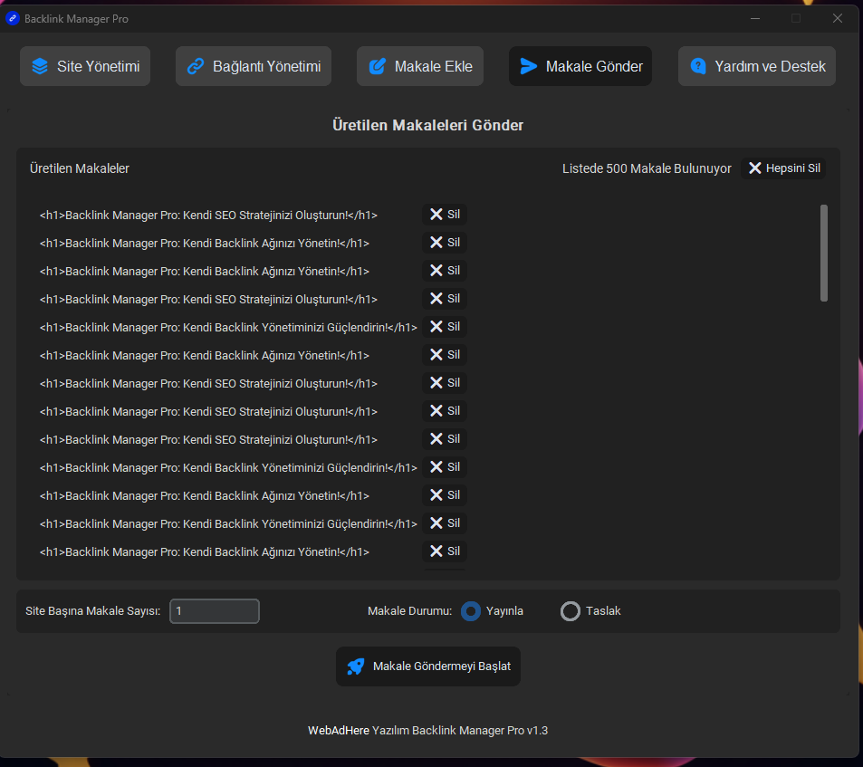
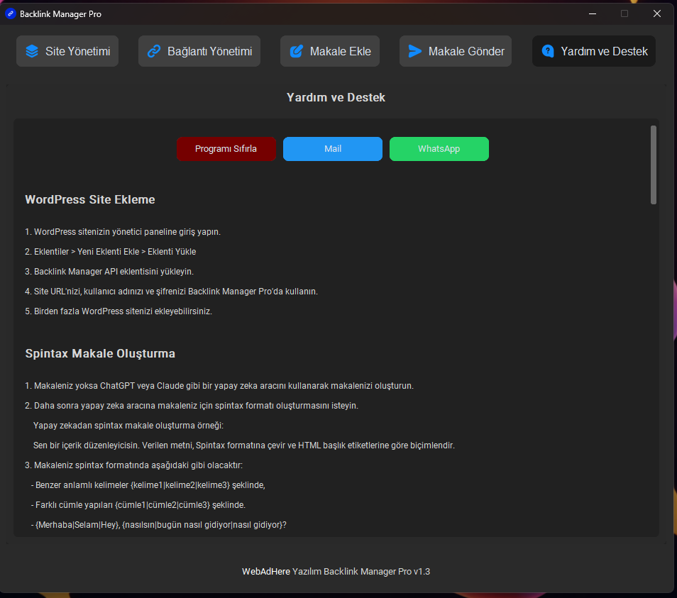

# Backlink Manager Pro

[](https://github.com/cangurel81/backlink-manager-pro/releases/latest)
[](https://github.com/cangurel81/backlink-manager-pro/releases/latest)
[](LICENSE)
[](https://github.com/cangurel81/backlink-manager-pro/releases/latest)
[](https://www.python.org/downloads/)
[](https://webadhere.com/yazilim-cozumleri-2/backlink-manager-pro/)

Kendi WordPress sitelerinle güçlü bir backlink ağı kurman için Türkçe arayüzlü, hafif ve hızlı masaüstü uygulaması.
Spintax şablonlarından trilyonlarca farklı makale üretir, görsellerini ekler ve WordPress REST API üzerinden
sitelerine toplu olarak yayınlar. İster 1 siten olsun ister 1000 — kontrol tamamen sende.

[Ürün sayfası](https://webadhere.com/yazilim-cozumleri-2/backlink-manager-pro/) ·
[Exe indir](https://github.com/cangurel81/backlink-manager-pro/releases/latest/download/BacklinkManagerPro.exe) ·
[Kurulum](#kurulum) · [Ekran görüntüleri](#ekran-görüntüleri) · [SSS](#sıkça-sorulan-sorular)

---

## Ne işe yarar?

Money Robot, SENuke gibi araçların kendi siteleri üzerinden çalışmasına alternatif olarak geliştirildi.
Backlink Manager Pro **senin kendi WordPress sitelerini** kullanır: onları birbirine bağlayarak domain
otoriteni güçlendirir, diğer sitelerini desteklemek için kullanabilirsin. İçerikler kendi sitene eklendiği
için Google Search Console kayıtlarıyla takip edilebilir ve hızla dizine eklenir.

- **Backlink ağı:** site başına eklenen backlink sayısını ve içerik sayısını sen belirlersin.
- **Spintax üretimi:** `{bir|iki|üç}` kalıplarıyla her siteye farklı, özgün yazılar.
- **Yayın kontrolü:** taslak olarak kaydet veya doğrudan yayınla; site başına paylaşım oranı ayrı ayarlanır.
- **Hafif ve hızlı:** minimum kaynak kullanımı, paralel gönderim, sistemi yormayan çalışma.
- **Güvenli API:** şifrelemeli endpoint'lerle çalışan Backlink Manager API eklentisi.
- **Yedekleme:** tüm veri dosyalarını tek arşive alma ve geri yükleme.

## Kurulum

### Windows exe (önerilen)

[En son sürümdeki `BacklinkManagerPro.exe`](https://github.com/cangurel81/backlink-manager-pro/releases/latest/download/BacklinkManagerPro.exe) dosyasını indir ve çalıştır. İmzasız exe olduğu için Windows SmartScreen uyarısı çıkabilir:
**More info → Run anyway** yolunu izle. Kurulum gerektirmez, taşınabilir olarak çalışır.

### Kaynaktan çalıştırma

```powershell
python -m pip install -r requirements.txt
python main.py
```

Python 3.10+ gerekir. Uygulama aynı klasördeki JSON dosyalarını kullanır.

### İlk kullanım

1. Hedef WordPress sitesine `backlink-manager-api.php` eklentisini kur (aşağıda detay var).
2. Uygulamadan siteyi ekle: URL, kullanıcı adı ve şifre ile bağlantıyı doğrula.
3. Backlink domain'lerini ve kategorilerini listeye ekle.
4. Makale şablonunu spintax ile yaz; anahtar kelime ve görsel kaynaklarını seç.
5. **Önizle** ile içeriği kontrol et, sonra taslak olarak kaydet veya yayınla.

## Yapılandırma dosyaları

Repoda bu dosyalar **boş şablon** (`[]`) olarak gelir; gerçek veri asla commit edilmez.

| Dosya | İçerik |
|---|---|
| `sites.json` | Hedef siteler: `url`, `username`, `auth_token`, `api_type` |
| `backlinks.json` | Backlink domain listesi ve kategori eşleştirmeleri |
| `articles.json` | Makale şablonları: `title`, `content`, `image_urls` |

> **Güvenlik:** `sites.json` içindeki `auth_token` değerleri oturum anahtarıdır. Kendi verilerini girdikten
> sonra bu dosyaları **asla** commit etme veya paylaşma.

## WordPress API eklentisi

`backlink-manager-api.php` (veya hazır `backlink-manager-api.zip`) hedef WordPress sitesine kurulacak
eklentidir. JWT anahtarını `wp_salt('auth')` ile kendisi üretir; şu uçları açar:

- `POST /wp-json/backlink-manager/v1/auth`
- `POST /wp-json/backlink-manager/v1/posts`
- `POST /wp-json/backlink-manager/v1/upload-image`

## Ekran görüntüleri

**1 — WordPress siteni endpoint API eklentisiyle ekle**



**2 — Backlink'leri sisteme ekle, otomatik yazılara istediğin sayıda bağlantı girdir**



**3 — Yüksek hızda, trilyonlarca varyasyonda makale üret; önizleme ile tek tuşta kontrol et**



**4 — İçeriklerini istediğin kaynaktan görsellerle zenginleştir**



**5 — Anahtar kelimeleri cümle bütünlüğünü bozmadan bağlantılara ekle; yoksa rastgele yerleştir**



**6 — Otomatik yazıları sitelere yüklemeden taslak veya yayın seçenekleriyle yönet**



**7 — Kapsamlı destek paneli: programın içinde sorularına hızlı çözümler**



## Sıkça sorulan sorular

**Backlink Manager Pro tam olarak ne işe yarar?**
Kendi WordPress sitelerinle güçlü bir backlink ağı oluşturmanı sağlar. Windows cihazlarda çalışır, güncel
sistemlerde kullanılması önerilir. Sitelerini birbirine bağlayarak güçlendirebilir veya başka bir siteni
desteklemek için kullanabilirsin.

**İçeriğinde hazır siteler var mı?**
Hayır. Program hazır site içermez; kendi sitelerini sağladığımız API eklentisiyle sen bağlarsın.

**Lisans anahtarı gerekiyor mu?**
Hayır. Bu sürüm lisans doğrulaması olmadan derlenmiştir, indirip doğrudan kullanabilirsin.

## Lisans ve destek

GPL-3.0 — detaylar için [LICENSE](LICENSE).

Geliştirici ve destek: [WebAdHere](https://webadhere.com/yazilim-cozumleri-2/backlink-manager-pro/) ·
info@webadhere.com

---

## English summary

Windows desktop tool for building your own WordPress backlink network. Generate unlimited spintax-based
articles, add images and keyword links, then publish them to your sites in bulk through the bundled REST API
plugin. Ships with empty data files — no sites, credentials, or license keys included. GPL-3.0.
[Download the exe](https://github.com/cangurel81/backlink-manager-pro/releases/latest/download/BacklinkManagerPro.exe).
